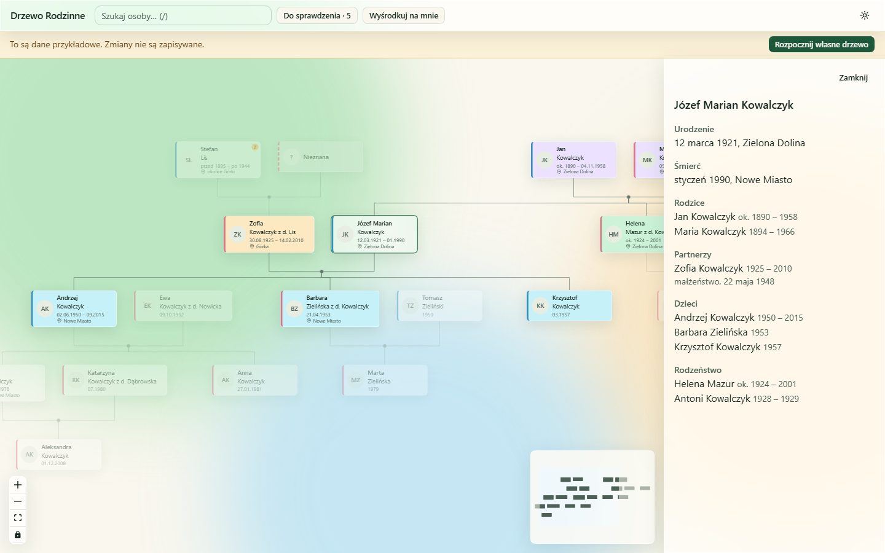

# Drzewo Rodzinne

Prywatna, lokalna aplikacja do budowania i przeglądania drzewa genealogicznego rodziny. Pozwala szybko dodawać osoby i relacje, zapisywać niepewne fakty, notatki i poszlaki oraz sprawdzać, co jeszcze trzeba potwierdzić. Interfejs jest po polsku.



## Wymagania

- Node.js `^22.18.0` lub `>=24.12.0`
- pnpm 12 (wersja wskazana w `package.json`)

## Uruchomienie

```bash
pnpm install
pnpm dev
```

Bez własnych danych aplikacja pokazuje dane przykładowe w trybie tylko do odczytu, z belką „To są dane przykładowe. Zmiany nie są zapisywane.” i przyciskiem „Rozpocznij własne drzewo”. Belka pokazuje też ścieżkę, pod którą aplikacja szukała danych (przydatne przy literówce w `FAMILY_DATA_DIR`).

Inne komendy: `pnpm test`, `pnpm test:e2e`, `pnpm lint`, `pnpm typecheck`, `pnpm build`, `pnpm validate:data` (sprawdza `family.json` w folderze danych), `pnpm check:leaks` (po buildzie sprawdza, że nic z Twoich danych nie trafiło do repozytorium ani do `dist/`).

## Struktura folderów

- `src/`: kod aplikacji: `app` (start, panel boczny, ekran powitalny), `domain` (model, daty, relacje, układ drzewa), `data` (odczyt i zapis), `features` (drzewo, osoba, edytor, wyszukiwarka, „Do sprawdzenia”), `stores`, `components`, `shared`, `styles`
- `vite-plugins/`: zapis danych dla `pnpm dev`; `scripts/`: walidacja danych i ochrona przed wyciekiem
- `tests/e2e/`: testy Playwright; `tests/fixtures/`: dane i pomocniki testowe
- `data/seed/`: wymyślona rodzina demo; `data/family/`: Twoje dane (poza repozytorium kodu)
- `docs/`: specyfikacja, plany, decyzje (ADR) i [kryteria akceptacji](docs/acceptance.md)

## Twoje dane

Prawdziwe dane leżą w folderze `data/family/`, który jest ignorowany przez git, więc nie trafią do tego publicznego repozytorium. Ścieżkę można zmienić zmienną `FAMILY_DATA_DIR` (wzór w `.env.example`).

Zalecane jest osobne, prywatne repozytorium na dane, np. `family_tree-data`, które daje kopię zapasową i historię zmian:

1. Załóż prywatne repozytorium `family_tree-data` na GitHubie.
2. Sklonuj je do folderu danych:

   ```bash
   git clone <url> data/family
   ```

3. Commity w repozytorium danych robisz ręcznie.

Wzór `.gitignore` dla repozytorium danych:

```gitignore
.backups/
*.tmp
```

Aplikacja zapisuje kopie poprzednich wersji `family.json` w `.backups/` (maksymalnie 20), więc nie ma potrzeby ich wersjonować. Pliki `*.tmp` to pozostałości po przerwanym zapisie atomowym.

## Edycja danych

Zmiany zapisują się automatycznie w `data/family/family.json` (ok. pół sekundy po ostatniej zmianie; przy zamykaniu karty od razu). Stan zapisu widać w pasku górnym.

- **Pierwsza osoba:** po „Rozpocznij własne drzewo” formularz pyta o Ciebie („Ja”).
- **Krewni:** zaznacz osobę w drzewie i użyj przycisków „+” (nad węzłem: rodzic, rodzeństwo; pod węzłem: dziecko, partner). Można dodać nową osobę albo połączyć z istniejącą. Aplikacja blokuje cykle i trzeciego rodzica biologicznego.
- **Karta osoby** (panel boczny): „Edytuj” zmienia imiona, nazwisko, nazwisko rodowe, daty i miejsca, biografię i notatki badawcze. Daty przyjmują kwalifikatory, np. `ok. 1890`, `przed 1939`, `03.1921`; podgląd pokazuje, jak data zostanie zrozumiana. Fakt można oznaczyć „do potwierdzenia”. W tym samym formularzu dodasz zdjęcie (zapisywane jako WebP w `photos/`) i usuniesz osobę.
- **Wyszukiwarka:** pole w pasku górnym, skróty `/` i `Ctrl+K`. Nie rozróżnia wielkości liter ani polskich znaków („wisniewska” znajdzie „Wiśniewska”).
- **„Do sprawdzenia”:** przycisk z licznikiem w pasku górnym; lista osób z faktami „do potwierdzenia” i osób nieznanych.
- **Motyw** jasny lub ciemny: przełącznik w pasku górnym (domyślnie według systemu).

Gdy aplikacja jest otwarta w dwóch kartach, zapis ze starszej karty zostaje odrzucony z komunikatem „Dane zmieniły się w innej karcie, odśwież”. Przed każdym zapisem aplikacja kopiuje poprzednią wersję do `.backups/` (20 najnowszych kopii; przy autozapisie to ostatnie kilka minut pracy, dłuższą historię daje repozytorium danych). Plik edytowany ręcznie sprawdzisz komendą `pnpm validate:data`; uszkodzony plik aplikacja pokazuje jako ekran błędu i niczego nie nadpisuje.
